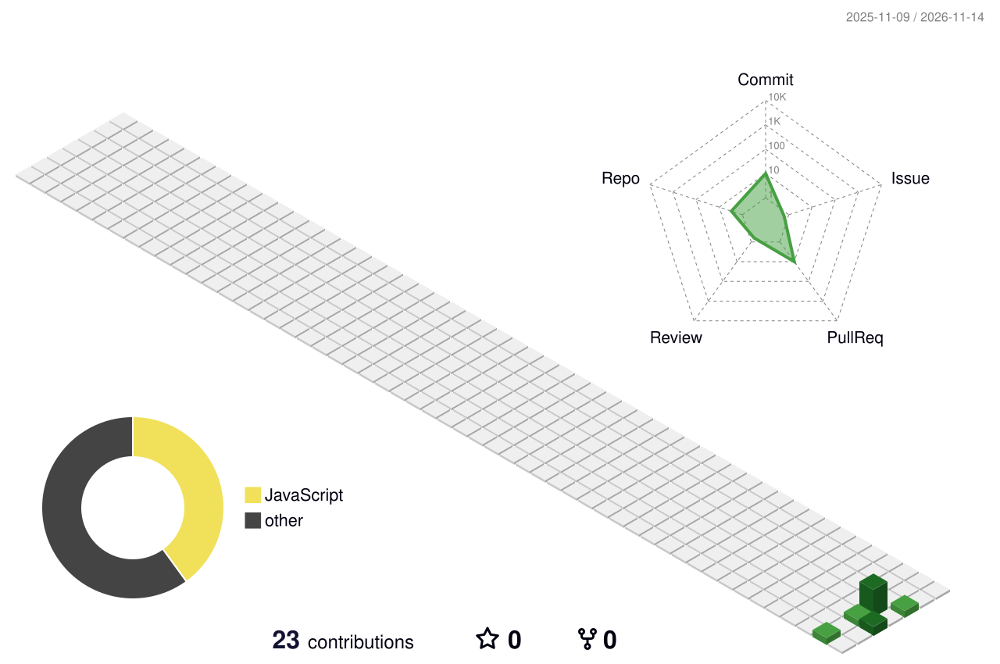

<!-- ==============================================================
     NURAZIM'S GITHUB PROFILE README — MIDNIGHT VIOLET & CYAN
     GitHub:   nurazim-dev
     LeetCode: nurazimdev
============================================================== -->

<!-- ANIMATED LIQUID HERO BANNER (Dark & Light theme) -->
<p align="center">
  <picture>
    <source
      media="(prefers-color-scheme: dark)"
      srcset="https://capsule-render.vercel.app/api?type=venom&color=0:0D0B21,50:4C1D95,100:0891B2&height=220&section=header&text=Nurazim&fontSize=60&fontColor=FFFFFF&animation=twinkling&fontAlignY=42&desc=Full-Stack%20JavaScript%20in%20the%20Making&descAlignY=66&descSize=18&descColor=BAE6FD"
    />
    <source
      media="(prefers-color-scheme: light)"
      srcset="https://capsule-render.vercel.app/api?type=venom&color=0:4C1D95,50:7C3AED,100:06B6D4&height=220&section=header&text=Nurazim&fontSize=60&fontColor=FFFFFF&animation=twinkling&fontAlignY=42&desc=Full-Stack%20JavaScript%20in%20the%20Making&descAlignY=66&descSize=18&descColor=E0F2FE"
    />
    
  </picture>
</p>

<!-- ANIMATED TERMINAL TYPING INTRO -->
<p align="center">
  <picture>
    <source
      media="(prefers-color-scheme: dark)"
      srcset="https://readme-typing-svg.demolab.com?font=Fira+Code&weight=500&size=20&duration=2800&pause=1000&color=A78BFA&center=true&vCenter=true&width=680&lines=%24+whoami+%E2%86%92+Nurazim+%7C+Web+Developer;%24+stack++%E2%86%92+HTML5+%C2%B7+CSS3+%C2%B7+JavaScript;%24+next+++%E2%86%92+React+%E2%86%92+Node.js+%E2%86%92+Express+%E2%86%92+SQL;%24+goal+++%E2%86%92+Full-Stack+JavaScript+Developer"
    />
    <source
      media="(prefers-color-scheme: light)"
      srcset="https://readme-typing-svg.demolab.com?font=Fira+Code&weight=500&size=20&duration=2800&pause=1000&color=6D28D9&center=true&vCenter=true&width=680&lines=%24+whoami+%E2%86%92+Nurazim+%7C+Web+Developer;%24+stack++%E2%86%92+HTML5+%C2%B7+CSS3+%C2%B7+JavaScript;%24+next+++%E2%86%92+React+%E2%86%92+Node.js+%E2%86%92+Express+%E2%86%92+SQL;%24+goal+++%E2%86%92+Full-Stack+JavaScript+Developer"
    />
    
  </picture>
</p>

<!-- LIVE STATUS & VISITOR COUNTER -->
<p align="center">
  
  
  
</p>

<p align="center">
  
</p>

<!-- DEVELOPER PROFILE CARD -->
<h2 align="center">⚡ About Me</h2>

<p align="center">
  Web developer focused on mastering modern JavaScript from the ground up — building clean fundamentals today and growing systematically into a <b>Full-Stack JavaScript Developer</b>.
</p>

```javascript
const nurazim = {
  role: "Web Developer → Aspiring Full-Stack JavaScript Developer",
  coreStack: ["HTML5", "CSS3", "JavaScript"],
  learningRoadmap: ["React", "Node.js", "Express.js", "REST APIs", "SQL & Databases"],
  practice: ["Learning in public", "Consistent GitHub commits", "LeetCode problem solving"],
  mindset: "Strong fundamentals first, full-stack systems next."
};
```

<p align="center">
  
</p>

<!-- TECH STACK & INTERACTIVE ROADMAP -->
<h2 align="center">🧰 Tech Stack &amp; Roadmap</h2>

<p align="center"><b>Core Stack</b></p>

<p align="center">
  <picture>
    <source media="(prefers-color-scheme: dark)" srcset="https://skillicons.dev/icons?i=html,css,js&theme=dark" />
    <source media="(prefers-color-scheme: light)" srcset="https://skillicons.dev/icons?i=html,css,js&theme=light" />
    
  </picture>
</p>

<p align="center"><b>Currently Learning · Full-Stack Roadmap</b></p>

<p align="center">
  <picture>
    <source media="(prefers-color-scheme: dark)" srcset="https://skillicons.dev/icons?i=react,nodejs,express&theme=dark" />
    <source media="(prefers-color-scheme: light)" srcset="https://skillicons.dev/icons?i=react,nodejs,express&theme=light" />
    
  </picture>
</p>

<p align="center">
  
  
</p>

<div align="center">
  <details>
    <summary><b>🗺️ Click to expand my Full-Stack JS Roadmap</b></summary>

<br />

| Stage | Area | Technologies | Status |
| :---: | :--- | :--- | :--- |
| **01** | Frontend Foundation | `HTML5` · `CSS3` · `JavaScript` | ✅ Active Foundation |
| **02** | Modern Frontend | `React` | 🚀 Next Step |
| **03** | Backend &amp; APIs | `Node.js` · `Express.js` · `REST APIs` | 🧭 Roadmap |
| **04** | Data Layer | `SQL & Databases` | 🧭 Roadmap |

  </details>
</div>

<p align="center">
  
</p>

<!-- ANALYTICS DASHBOARD (Tokyo Night Dark & Clean Light) -->
<h2 align="center">📊 Analytics &amp; Coding Activity</h2>

<p align="center">
  <picture>
    <source
      media="(prefers-color-scheme: dark)"
      srcset="https://github-readme-stats.vercel.app/api?username=nurazim-dev&show_icons=true&bg_color=1A1B27&border_color=3B2F63&title_color=A78BFA&icon_color=38BDF8&text_color=E2E8F0&ring_color=38BDF8&border_radius=12&card_width=430"
    />
    <source
      media="(prefers-color-scheme: light)"
      srcset="https://github-readme-stats.vercel.app/api?username=nurazim-dev&show_icons=true&bg_color=FFFFFF&border_color=E2E8F0&title_color=6D28D9&icon_color=0891B2&text_color=1E293B&ring_color=0891B2&border_radius=12&card_width=430"
    />
    
  </picture>
  <picture>
    <source
      media="(prefers-color-scheme: dark)"
      srcset="https://github-readme-stats.vercel.app/api/top-langs/?username=nurazim-dev&layout=donut&langs_count=6&bg_color=1A1B27&border_color=3B2F63&title_color=A78BFA&text_color=E2E8F0&border_radius=12&card_width=360"
    />
    <source
      media="(prefers-color-scheme: light)"
      srcset="https://github-readme-stats.vercel.app/api/top-langs/?username=nurazim-dev&layout=donut&langs_count=6&bg_color=FFFFFF&border_color=E2E8F0&title_color=6D28D9&text_color=1E293B&border_radius=12&card_width=360"
    />
    
  </picture>
</p>

<p align="center">
  <picture>
    <source
      media="(prefers-color-scheme: dark)"
      srcset="https://streak-stats.demolab.com?user=nurazim-dev&background=1A1B27&border=3B2F63&ring=38BDF8&fire=A78BFA&currStreakLabel=A78BFA&sideLabels=94A3B8&currStreakNum=F8FAFC&sideNums=F8FAFC&dates=94A3B8&stroke=3B2F63&border_radius=12"
    />
    <source
      media="(prefers-color-scheme: light)"
      srcset="https://streak-stats.demolab.com?user=nurazim-dev&background=FFFFFF&border=E2E8F0&ring=0891B2&fire=6D28D9&currStreakLabel=6D28D9&sideLabels=64748B&currStreakNum=0F172A&sideNums=0F172A&dates=64748B&stroke=E2E8F0&border_radius=12"
    />
    
  </picture>
</p>

<p align="center">
  <a href="https://leetcode.com/u/nurazimdev/">
    <picture>
      <source
        media="(prefers-color-scheme: dark)"
        srcset="https://leetcard.jacoblin.cool/nurazimdev?theme=nord&font=Fira_Code&ext=heatmap&animation=true&border=1&radius=12"
      />
      <source
        media="(prefers-color-scheme: light)"
        srcset="https://leetcard.jacoblin.cool/nurazimdev?theme=light&font=Fira_Code&ext=heatmap&animation=true&border=1&radius=12"
      />
      
    </picture>
  </a>
</p>

<div align="center">
  <details>
    <summary><b>📈 Click to view Contribution Activity Graph</b></summary>
    <br />
    <picture>
      <source
        media="(prefers-color-scheme: dark)"
        srcset="https://github-readme-activity-graph.vercel.app/graph?username=nurazim-dev&bg_color=1A1B27&color=A78BFA&line=38BDF8&point=FFFFFF&area=true&area_color=7C3AED&hide_border=false&custom_title=Contribution%20Activity"
      />
      <source
        media="(prefers-color-scheme: light)"
        srcset="https://github-readme-activity-graph.vercel.app/graph?username=nurazim-dev&bg_color=FFFFFF&color=6D28D9&line=0891B2&point=1E1B4B&area=true&area_color=A78BFA&hide_border=false&custom_title=Contribution%20Activity"
      />
      
    </picture>
  </details>
</div>

<p align="center">
  
</p>

<!-- ANIMATED 3D CONTRIBUTION CALENDAR (auto-updated by .github/workflows/profile-3d.yml) -->
<h2 align="center">🧊 3D Contribution Calendar</h2>

<p align="center">
  <picture>
    <source media="(prefers-color-scheme: dark)" srcset="./profile-3d-contrib/profile-night-rainbow.svg" />
    <source media="(prefers-color-scheme: light)" srcset="./profile-3d-contrib/profile-green-animate.svg" />
    
  </picture>
</p>

<!-- ANIMATED CONTRIBUTION SNAKE (auto-updated by .github/workflows/snake.yml) -->
<h2 align="center">🐍 Contribution Snake</h2>

<p align="center">
  <picture>
    <source media="(prefers-color-scheme: dark)" srcset="./dist/github-snake-dark.svg" />
    <source media="(prefers-color-scheme: light)" srcset="./dist/github-snake.svg" />
    
  </picture>
</p>

<!-- DYNAMIC DAILY DEV QUOTE -->
<p align="center">
  <picture>
    <source media="(prefers-color-scheme: dark)" srcset="https://quotes-github-readme.vercel.app/api?type=horizontal&theme=tokyonight" />
    <source media="(prefers-color-scheme: light)" srcset="https://quotes-github-readme.vercel.app/api?type=horizontal&theme=default" />
    
  </picture>
</p>

<!-- CONNECT WITH ME -->
<h2 align="center">🌐 Connect With Me</h2>

<p align="center">
  <a href="https://github.com/nurazim-dev">
    
  </a>
  <a href="https://www.linkedin.com/in/nurazimdev">
    
  </a>
  <a href="https://t.me/nurazimdev">
    
  </a>
  <a href="https://www.instagram.com/nura3im">
    
  </a>
  <a href="https://leetcode.com/u/nurazimdev/">
    
  </a>
  <a href="mailto:nurazimdev@gmail.com">
    
  </a>
</p>

<!-- ANIMATED LIQUID FOOTER (Dark & Light theme) -->
<p align="center">
  <picture>
    <source
      media="(prefers-color-scheme: dark)"
      srcset="https://capsule-render.vercel.app/api?type=venom&color=0:0891B2,50:4C1D95,100:0D0B21&height=120&section=footer"
    />
    <source
      media="(prefers-color-scheme: light)"
      srcset="https://capsule-render.vercel.app/api?type=venom&color=0:06B6D4,50:7C3AED,100:4C1D95&height=120&section=footer"
    />
    
  </picture>
</p>
